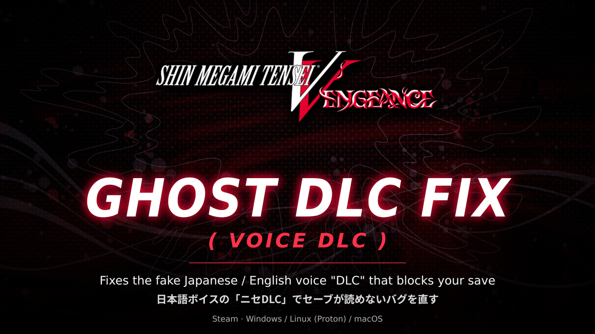

# Ghost DLC Fix (Voice DLC) - Shin Megami Tensei V: Vengeance (Steam)



[Français](#français) · [English](#english) · [日本語](#日本語)

---

## Français

### Ce que ça corrige

Sur certaines installations Steam de SMT V: Vengeance, le jeu affiche au démarrage que le DLC « Voix japonaises » est désactivé parce qu'il n'est pas téléchargé. Ensuite, impossible de charger sa sauvegarde : le jeu dit qu'elle contient du contenu téléchargeable qu'on ne possède pas.

Sauf que dans Vengeance, les voix japonaises ne sont plus un DLC. Elles sont incluses dans le jeu de base, on ne peut ni les acheter ni les télécharger à part. C'est un reste de la version Switch de SMT V, où c'était un vrai DLC.

### Ce que fait le mod

Dans la table des DLC du jeu, les lignes « voix japonaises » et « voix anglaises » pointent vers un faux numéro d'application Steam (`9999999`). Le jeu demande donc à Steam si on possède un DLC qui n'existe pas, et parfois Steam répond non.

Le mod remplace ce faux numéro par celui du jeu de base (`1875830`), que tout le monde possède forcément. C'est tout.

- L'exécutable du jeu n'est pas modifié.
- Les vrais DLC (missions, packs, difficulté, précommande) ne sont pas touchés et restent vérifiés normalement.
- Vos sauvegardes ne sont pas modifiées.

### Installation

**Option 1 : le fichier .pak (le plus simple)**

1. Allez dans le dossier du jeu : clic droit sur le jeu dans Steam -> Gérer -> Parcourir les fichiers locaux.
2. Ouvrez `Project/Content/Paks/`.
3. Créez un dossier `~mods` s'il n'existe pas.
4. Mettez-y `zz_GhostDLCFix_P.pak`.

**Option 2 : le patcher**

Le patcher génère le .pak lui-même à partir de vos fichiers du jeu, et vérifie que la table n'a pas changé avant de toucher à quoi que ce soit. Utile si le jeu reçoit une mise à jour.

```
ghost-dlc-fix "<dossier du jeu SMT5V>"
```

Pour le compiler vous-même (Windows, Linux ou macOS) : `cargo build --release`.

### Désinstallation

Supprimez `Project/Content/Paks/~mods/zz_GhostDLCFix_P.pak`.

### Pourquoi j'ai fait ça

J'avais le jeu et tous les DLC achetés sur Steam, et je ne pouvais plus charger ma seule sauvegarde à cause d'un « DLC » qui n'en est pas un. Le bug n'a jamais été corrigé, d'autres joueurs l'ont eu aussi, et il n'existait pas de solution. Alors je l'ai faite.

Testé sur la build Steam 17140961.

### Crédits et licence

Créé par AnnoyedDev. Le code du patcher est sous licence MIT (voir `LICENSE`), les bibliothèques utilisées sont listées dans `THIRD_PARTY.md`.

Shin Megami Tensei V: Vengeance, son logo et ses fichiers de données appartiennent à Atlus/Sega. Le fichier `.pak` contient une table de données du jeu modifiée : il n'est pas couvert par la licence MIT.

---

## English

### The problem

Some people on Steam get a popup when they start the game, saying the Japanese Voice DLC was disabled because it isn't downloaded. Then, when you try to load a save, the game refuses because the save "includes downloadable content".

Thing is, Vengeance ships with Japanese voices out of the box. There's no Japanese voice DLC to buy or download on Steam. It's left over from the original Switch release, where it was sold separately.

### How it works

The game keeps a small table with every DLC and its Steam app ID. The Japanese voice and English voice rows still use a placeholder ID, `9999999`, which isn't a real app. So when the game checks with Steam, it can come back as "not owned".

This mod points both rows to the base game's ID (`1875830`) instead. If you own the game, you own that ID, so the check goes through.

Nothing else gets touched:

- no changes to the exe
- the paid DLCs are still checked like before
- your saves stay as they are

### How to install

**The easy way: the .pak**

1. In Steam, right-click the game -> Manage -> Browse local files
2. Open `Project/Content/Paks/`
3. Make a folder called `~mods` (skip this if it's already there)
4. Put `zz_GhostDLCFix_P.pak` inside

**Or: the patcher**

It reads your own game files and makes the .pak for you. If an update ever changes the DLC table, it stops instead of writing something broken.

```
ghost-dlc-fix "<path to the SMT5V folder>"
```

Building from source works on Windows, Linux and macOS: `cargo build --release`

### Removing it

Just delete `Project/Content/Paks/~mods/zz_GhostDLCFix_P.pak`.

### Why

I bought the game and all the DLC on Steam, and still got locked out of my only save over a "DLC" that doesn't even exist. It's been broken like this for a while, other people have run into it, and nobody had a fix. So here's one.

Tested with Steam build 17140961.

### Credits / license

Made by AnnoyedDev. Patcher code: MIT (`LICENSE`). Third-party libraries: `THIRD_PARTY.md`.

Shin Megami Tensei V: Vengeance, its logo and its game data are owned by Atlus/Sega. The `.pak` includes an edited game data table, so the MIT license doesn't cover it.

---

## 日本語

### どんなバグ？

Steam版で、ゲームを起動したら「日本語ボイスのDLCはダウンロードされてないから無効にした」みたいなメッセージが出て、セーブを読もうとすると「ダウンロードコンテンツが入ってるからロードできない」って言われる。そういうバグ。

Vengeanceは日本語ボイスが最初から入ってるから、そもそもDLCとして売ってない。Switchの元のSMT Vのときのしくみが、そのまま残っちゃってるだけ。

### 中身の話

ゲームの中にDLCの一覧があって、それぞれにSteamのアプリ番号がついてる。日本語ボイスと英語ボイスだけ、仮の番号「`9999999`」のまま。そんなアプリはないから、Steamに聞くと「持ってない」になることがある。

このMODでは、その2つをゲーム本体の番号「`1875830`」にしてある。ゲームを買ってれば絶対持ってる番号だから、チェックで止まらなくなる。

ほかはさわってない：

- exeはそのまま
- お金を払うDLCのチェックは今まで通り
- セーブデータもそのまま

### 入れかた

**.pakを置くのがいちばん早い**

1. Steamでゲームを右クリック -> 管理 -> ローカルファイルを閲覧
2. `Project/Content/Paks/` に行く
3. `~mods` ってフォルダを作る（もうあるならそのままでOK）
4. `zz_GhostDLCFix_P.pak` をそこに置く

**パッチャーを使うやり方もある**

自分のゲームのファイルを読んで .pak を作るやつ。アップデートでDLCの一覧が変わってたら、変なものは作らずにそこで止まる。

```
ghost-dlc-fix "<SMT5Vのフォルダ>"
```

ソースからビルドするなら（Windows / Linux / macOS）：`cargo build --release`

### 外しかた

`Project/Content/Paks/~mods/zz_GhostDLCFix_P.pak` を消せば元通り。

### 作ったわけ

ゲームもDLCも全部Steamで買ったのに、ありもしない「DLC」のせいで一個しかないセーブが読めなくなった。けっこう前からこのままだし、ほかにも困ってる人がいるのに、直し方が見つからなかった。なら自分でやるか、って感じ。

Steamビルド 17140961 で確認してる。

### クレジット・ライセンス

作者：AnnoyedDev。パッチャーのコードはMIT（`LICENSE`）。ほかのライブラリのことは `THIRD_PARTY.md` に書いてある。

「真・女神転生V Vengeance」とロゴ、ゲームのデータはアトラスとセガのもの。`.pak` の中身はゲームのデータを書きかえたものだから、MITライセンスには入らない。
